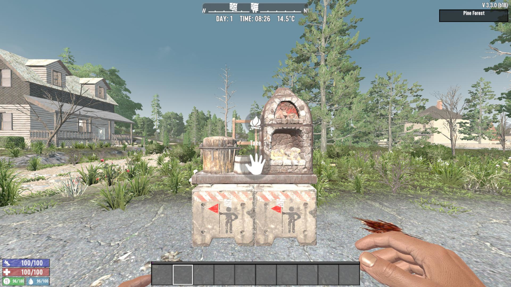

# Pickup Workstation Patch

This Mod removes the annoying restriction that prevents you from picking up workstations when they contain melted materials, fuel, or crafted items.

### Please Note

* **Pickup Time:** The time required to pick up a workstation has been adjusted from 15 seconds to **8 seconds**.
* **Item Behavior:** Any melted materials or completed items remaining inside will be dropped on the ground when you pick up the workstation (this behaves the exact same way as when the workstation is destroyed).

